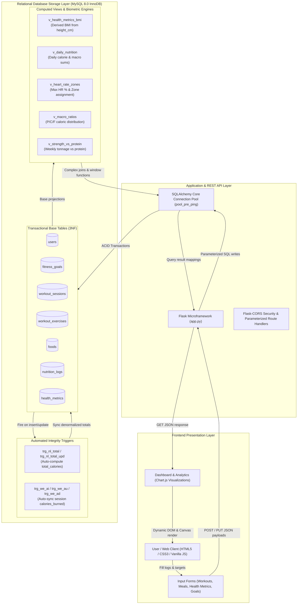

# APEX Fitness & Wellness Tracking System - Data Dictionary & Logic Flow

## 1. High-Level System Architecture & Logic Flow
The APEX platform is structured as an end-to-end data pipeline. Raw user metrics and daily lifestyle inputs flow from the interactive web frontend into ACID-compliant transactional MySQL tables. Real-time triggers calculate snapshots, views derive biometric calculations and aggregations, analytical queries process windowed insights, and a parameterized Flask REST API serves live JSON payloads to the Chart.js dashboard.

---

## 2. Complete Relational Data Dictionary

### 2.1 Table: `users`
Master entity catalog storing registered user profiles and anthropometric baselines.

| Column Name | Data Type | Nullable | Key / Constraints | Default | Description |
| :--- | :--- | :---: | :--- | :---: | :--- |
| `user_id` | `INT` | No | `PRIMARY KEY`, `AUTO_INCREMENT` | Auto | Unique surrogate primary key identifying each member. |
| `full_name` | `VARCHAR(100)` | No | Standard text constraint | None | Member's full legal name. |
| `email` | `VARCHAR(120)` | No | `UNIQUE` | None | Unique login and contact email address. |
| `date_of_birth` | `DATE` | No | Valid calendar date | None | Date of birth, utilized for dynamic age and max heart rate calculations. |
| `gender` | `ENUM` | No | `'Male', 'Female', 'Other'` | None | Biological sex / gender categorization for metabolic basal rate analysis. |
| `height_cm` | `DECIMAL(5,1)`| No | `CHECK (height_cm > 0 AND height_cm < 280)` | None | Member standing height in centimeters; referenced by BMI views. |
| `registration_date` | `DATE` | No | Current timestamp | `CURRENT_DATE` | Date when the member joined the fitness platform. |

---

### 2.2 Table: `fitness_goals`
Captures target fitness objectives, milestones, and deadlines for each user.

| Column Name | Data Type | Nullable | Key / Constraints | Default | Description |
| :--- | :--- | :---: | :--- | :---: | :--- |
| `goal_id` | `INT` | No | `PRIMARY KEY`, `AUTO_INCREMENT` | Auto | Unique surrogate key for the fitness goal. |
| `user_id` | `INT` | No | `FOREIGN KEY` -> `users(user_id)` `ON DELETE CASCADE` | None | Reference to the owner user profile. |
| `goal_type` | `ENUM` | No | `'Weight Loss', 'Weight Gain', 'Muscle Building', 'General Fitness', 'Endurance'` | None | Target category classification. |
| `target_weight_kg` | `DECIMAL(5,2)`| Yes | `CHECK (target_weight_kg > 0)` | `NULL` | Target body mass in kilograms. |
| `target_calories` | `INT` | Yes | `CHECK (target_calories > 0)` | `NULL` | Daily target caloric intake objective. |
| `target_steps` | `INT` | Yes | `CHECK (target_steps >= 0)` | `NULL` | Daily target step count goal. |
| `target_date` | `DATE` | Yes | Future date | `NULL` | Target calendar date for goal completion. |
| `status` | `ENUM` | No | `'Active', 'Achieved', 'Abandoned'` | `'Active'` | Current progression state of the goal. |

---

### 2.3 Table: `exercises`
Reference catalog of structured exercise types, categories, and anatomical targets.

| Column Name | Data Type | Nullable | Key / Constraints | Default | Description |
| :--- | :--- | :---: | :--- | :---: | :--- |
| `exercise_id` | `INT` | No | `PRIMARY KEY`, `AUTO_INCREMENT` | Auto | Unique identifier for the exercise activity. |
| `exercise_name` | `VARCHAR(80)` | No | `UNIQUE` | None | Unique official name of the exercise (e.g. "Bench Press", "Squats"). |
| `category` | `ENUM` | No | `'Strength', 'Cardio', 'Flexibility', 'HIIT'` | None | Physiological workout category. |
| `muscle_group` | `VARCHAR(40)` | No | Standard text constraint | None | Primary anatomical focus (e.g., "Chest", "Legs", "Back", "Core"). |
| `description` | `VARCHAR(255)`| Yes | Standard text constraint | `NULL` | Instructional summary of proper exercise biomechanics. |

---

### 2.4 Table: `workout_sessions`
Captures discrete workout events executed by members over calendar dates and times.

| Column Name | Data Type | Nullable | Key / Constraints | Default | Description |
| :--- | :--- | :---: | :--- | :---: | :--- |
| `workout_id` | `INT` | No | `PRIMARY KEY`, `AUTO_INCREMENT` | Auto | Unique identifier for the individual workout session. |
| `user_id` | `INT` | No | `FOREIGN KEY` -> `users(user_id)` `ON DELETE CASCADE` | None | Reference to the member who performed the session. |
| `workout_date` | `DATE` | No | `INDEX idx_ws_date` | None | Calendar date on which the workout took place. |
| `start_time` | `TIME` | No | Valid clock time | None | Workout commencement time. |
| `end_time` | `TIME` | No | `CHECK (end_time > start_time)` | None | Workout conclusion time. |
| `workout_type` | `VARCHAR(40)` | No | Standard text constraint | None | High-level workout classification (e.g. "Strength", "Cardio", "HIIT"). |
| `calories_burned`| `INT` | No | `CHECK (calories_burned >= 0)` | `0` | Total energy expenditure; auto-aggregated via child triggers. |
| `notes` | `VARCHAR(255)`| Yes | Standard text constraint | `NULL` | Optional athlete observations, fatigue notes, or workout log text. |

---

### 2.5 Table: `workout_exercises`
Junction table resolving the Many-to-Many relationship between `workout_sessions` and `exercises`.

| Column Name | Data Type | Nullable | Key / Constraints | Default | Description |
| :--- | :--- | :---: | :--- | :---: | :--- |
| `workout_exercise_id`| `INT` | No | `PRIMARY KEY`, `AUTO_INCREMENT` | Auto | Unique identifier for the session exercise drill item. |
| `workout_id` | `INT` | No | `FOREIGN KEY` -> `workout_sessions(workout_id)` `CASCADE` | None | Reference to the parent workout session header. |
| `exercise_id` | `INT` | No | `FOREIGN KEY` -> `exercises(exercise_id)` `RESTRICT` | None | Reference to the master exercise reference table. |
| `sets` | `INT` | Yes | `CHECK (sets >= 0)` | `NULL` | Number of sets executed. |
| `repetitions` | `INT` | Yes | `CHECK (repetitions >= 0)` | `NULL` | Repetitions executed per set. |
| `weight_used_kg` | `DECIMAL(6,2)`| Yes | `CHECK (weight_used_kg >= 0)` | `NULL` | External resistance load lifted in kilograms. |
| `duration_minutes`| `INT` | Yes | `CHECK (duration_minutes >= 0)` | `NULL` | Active drill duration in minutes. |
| `calories_burned`| `INT` | No | `CHECK (calories_burned >= 0)` | `0` | Estimated calories burned for this specific drill. |

---

### 2.6 Table: `foods`
Nutritional reference catalog containing standardized macronutrient metrics per portion.

| Column Name | Data Type | Nullable | Key / Constraints | Default | Description |
| :--- | :--- | :---: | :--- | :---: | :--- |
| `food_id` | `INT` | No | `PRIMARY KEY`, `AUTO_INCREMENT` | Auto | Unique identifier for the food catalog entry. |
| `food_name` | `VARCHAR(80)` | No | `UNIQUE` | None | Unique food descriptor (e.g., "Oatmeal", "Salmon", "Boiled Egg"). |
| `category` | `VARCHAR(40)` | No | Standard text constraint | None | Food group classification (Grains, Protein, Dairy, Vegetable, Fruit). |
| `serving_size` | `VARCHAR(40)` | No | Standard text constraint | None | Standardized portion reference (e.g., "1 cup", "100 g", "1 scoop"). |
| `calories` | `DECIMAL(7,2)`| No | `CHECK (calories >= 0)` | None | Total energy content per standard serving (in kcal). |
| `protein_g` | `DECIMAL(6,2)`| No | `CHECK (protein_g >= 0)` | None | Grams of dietary protein per serving. |
| `carbs_g` | `DECIMAL(6,2)`| No | `CHECK (carbs_g >= 0)` | None | Grams of carbohydrates per serving. |
| `fat_g` | `DECIMAL(6,2)`| No | `CHECK (fat_g >= 0)` | None | Grams of dietary fats/lipids per serving. |
| `fiber_g` | `DECIMAL(6,2)`| No | `CHECK (fiber_g >= 0)` | `0.00` | Grams of dietary fiber per serving. |

---

### 2.7 Table: `nutrition_logs`
User dietary intake diary recording consumed food items, portion quantities, and caloric totals.

| Column Name | Data Type | Nullable | Key / Constraints | Default | Description |
| :--- | :--- | :---: | :--- | :---: | :--- |
| `nutrition_log_id`| `INT` | No | `PRIMARY KEY`, `AUTO_INCREMENT` | Auto | Unique identifier for the food logging entry. |
| `user_id` | `INT` | No | `FOREIGN KEY` -> `users(user_id)` `ON DELETE CASCADE` | None | Reference to the consuming member. |
| `food_id` | `INT` | No | `FOREIGN KEY` -> `foods(food_id)` `ON DELETE RESTRICT`| None | Reference to the master food catalog entry. |
| `log_date` | `DATE` | No | `INDEX idx_nl_date` | None | Calendar date when the meal was consumed. |
| `meal_type` | `ENUM` | No | `'Breakfast', 'Lunch', 'Dinner', 'Snack'` | None | Meal occasion categorization. |
| `quantity` | `DECIMAL(5,2)`| No | `CHECK (quantity > 0)` | None | Multiplier representing the number of servings consumed. |
| `total_calories` | `DECIMAL(8,2)`| No | `CHECK (total_calories >= 0)` | `0.00` | Historical caloric snapshot calculated automatically via DB trigger. |

---

### 2.8 Table: `health_metrics`
Time-series biometric records capturing weight, resting vital signs, sleep, and physical activity.

| Column Name | Data Type | Nullable | Key / Constraints | Default | Description |
| :--- | :--- | :---: | :--- | :---: | :--- |
| `metric_id` | `INT` | No | `PRIMARY KEY`, `AUTO_INCREMENT` | Auto | Unique identifier for the biometric log. |
| `user_id` | `INT` | No | `FOREIGN KEY` -> `users(user_id)` `ON DELETE CASCADE` | None | Reference to the member being evaluated. |
| `record_datetime`| `DATETIME` | No | `INDEX idx_hm_dt` | None | Exact timestamp when biometric readings were captured. |
| `weight_kg` | `DECIMAL(5,2)`| No | `CHECK (weight_kg > 0 AND weight_kg < 500)` | None | Member body weight in kilograms. |
| `heart_rate` | `INT` | Yes | `CHECK (heart_rate BETWEEN 25 AND 250)` | `NULL` | Instantaneous heart rate reading (beats per minute). |
| `resting_heart_rate`| `INT` | Yes | `CHECK (resting_heart_rate BETWEEN 25 AND 150)` | `NULL` | Resting heart rate baseline (beats per minute). |
| `steps` | `INT` | No | `CHECK (steps >= 0)` | `0` | Total pedometer steps recorded during the day. |
| `calories_burned`| `INT` | No | `CHECK (calories_burned >= 0)` | `0` | Daily basal + active burned calories from wearable/sensor. |
| `sleep_hours` | `DECIMAL(4,2)`| No | `CHECK (sleep_hours BETWEEN 0 AND 24)` | `0.00` | Total hours of recorded sleep in the past 24 hours. |
