# APEX Fitness & Wellness Tracking System - Entity Relationship Diagram

## 1. Overview
The APEX database schema is engineered in **Third Normal Form (3NF)** with strict relational integrity, referential constraints, and domain validation. The database models four core fitness tracking subsystems:
1. **User Profile & Objectives**: `users`, `fitness_goals`
2. **Activity & Exercise Tracking**: `exercises`, `workout_sessions`, `workout_exercises`
3. **Dietary & Nutrition Tracking**: `foods`, `nutrition_logs`
4. **Biometric & Health Monitoring**: `health_metrics`

---

## 2. Mermaid Entity-Relationship Diagram (Crow's Foot Notation)

```mermaid
erDiagram
    users ||--o{ fitness_goals : "sets (1:N)"
    users ||--o{ workout_sessions : "logs (1:N)"
    users ||--o{ nutrition_logs : "records (1:N)"
    users ||--o{ health_metrics : "tracks (1:N)"
    workout_sessions ||--|{ workout_exercises : "contains (1:N)"
    exercises ||--o{ workout_exercises : "categorizes (1:N)"
    foods ||--o{ nutrition_logs : "itemizes (1:N)"

    users {
        int user_id PK "Auto Increment"
        string full_name "NOT NULL"
        string email UK "NOT NULL, UNIQUE"
        date date_of_birth "NOT NULL"
        enum gender "Male | Female | Other"
        decimal height_cm "CHECK (0 < height_cm < 280)"
        date registration_date "DEFAULT CURRENT_DATE"
    }

    fitness_goals {
        int goal_id PK "Auto Increment"
        int user_id FK "REFERENCES users(user_id) ON DELETE CASCADE"
        enum goal_type "Weight Loss | Weight Gain | Muscle Building | General Fitness | Endurance"
        decimal target_weight_kg "CHECK > 0"
        int target_calories "CHECK > 0"
        int target_steps "CHECK >= 0"
        date target_date "Target completion deadline"
        enum status "Active | Achieved | Abandoned"
    }

    exercises {
        int exercise_id PK "Auto Increment"
        string exercise_name UK "NOT NULL, UNIQUE"
        enum category "Strength | Cardio | Flexibility | HIIT"
        string muscle_group "NOT NULL"
        string description "Exercise instructions"
    }

    workout_sessions {
        int workout_id PK "Auto Increment"
        int user_id FK "REFERENCES users(user_id) ON DELETE CASCADE"
        date workout_date "NOT NULL"
        time start_time "NOT NULL"
        time end_time "CHECK (end_time > start_time)"
        string workout_type "NOT NULL"
        int calories_burned "Auto-summed via trigger"
        string notes "Session notes"
    }

    workout_exercises {
        int workout_exercise_id PK "Auto Increment"
        int workout_id FK "REFERENCES workout_sessions(workout_id) ON DELETE CASCADE"
        int exercise_id FK "REFERENCES exercises(exercise_id) ON DELETE RESTRICT"
        int sets "CHECK >= 0"
        int repetitions "CHECK >= 0"
        decimal weight_used_kg "CHECK >= 0"
        int duration_minutes "CHECK >= 0"
        int calories_burned "Estimated / logged burn"
    }

    foods {
        int food_id PK "Auto Increment"
        string food_name UK "NOT NULL, UNIQUE"
        string category "Grains | Protein | Dairy | Fruit | Vegetable | etc"
        string serving_size "Standard portion measure"
        decimal calories "CHECK >= 0"
        decimal protein_g "CHECK >= 0"
        decimal carbs_g "CHECK >= 0"
        decimal fat_g "CHECK >= 0"
        decimal fiber_g "CHECK >= 0"
    }

    nutrition_logs {
        int nutrition_log_id PK "Auto Increment"
        int user_id FK "REFERENCES users(user_id) ON DELETE CASCADE"
        int food_id FK "REFERENCES foods(food_id) ON DELETE RESTRICT"
        date log_date "NOT NULL"
        enum meal_type "Breakfast | Lunch | Dinner | Snack"
        decimal quantity "Servings multiplier (> 0)"
        decimal total_calories "Snapshot = quantity * foods.calories (Trigger)"
    }

    health_metrics {
        int metric_id PK "Auto Increment"
        int user_id FK "REFERENCES users(user_id) ON DELETE CASCADE"
        datetime record_datetime "Timestamp of biometric reading"
        decimal weight_kg "CHECK (0 < weight_kg < 500)"
        int heart_rate "CHECK (25 <= heart_rate <= 250)"
        int resting_heart_rate "CHECK (25 <= resting_heart_rate <= 150)"
        int steps "CHECK >= 0"
        int calories_burned "Total daily baseline burn"
        decimal sleep_hours "CHECK (0 <= sleep_hours <= 24)"
    }
```

---

## 3. Structural Cardinality Analysis

| Relationship | Cardinality | Parent Entity | Child Entity | On Delete Action | Business Rule & Justification |
| :--- | :---: | :--- | :--- | :---: | :--- |
| **User Profile to Goals** | `1 : 0..*` | `users` | `fitness_goals` | `CASCADE` | A user can register multiple progressive goals; deleting a user account purges their associated targets. |
| **User to Workout Sessions** | `1 : 0..*` | `users` | `workout_sessions` | `CASCADE` | A user logs zero or many sessions over time; all session logs belong to exactly one user. |
| **Workout Session to Exercises** | `1 : 1..*` | `workout_sessions` | `workout_exercises` | `CASCADE` | Each workout session contains one or more exercise sets/drills. |
| **Master Exercise to Workout Exercise** | `1 : 0..*` | `exercises` | `workout_exercises` | `RESTRICT` | Master catalog of exercises. Deleting an exercise is restricted if historical workouts reference it, preventing orphan drill references. |
| **User to Nutrition Logs** | `1 : 0..*` | `users` | `nutrition_logs` | `CASCADE` | A user records their daily meals; cascading deletes ensure user privacy and GDPR compliance upon account removal. |
| **Master Food to Nutrition Logs** | `1 : 0..*` | `foods` | `nutrition_logs` | `RESTRICT` | Food reference catalog. Deletion is restricted if historical intake logs reference the food item. |
| **User to Health Metrics** | `1 : 0..*` | `users` | `health_metrics` | `CASCADE` | Daily biometric sensor and manual readings; cascade deleted with the user profile. |
